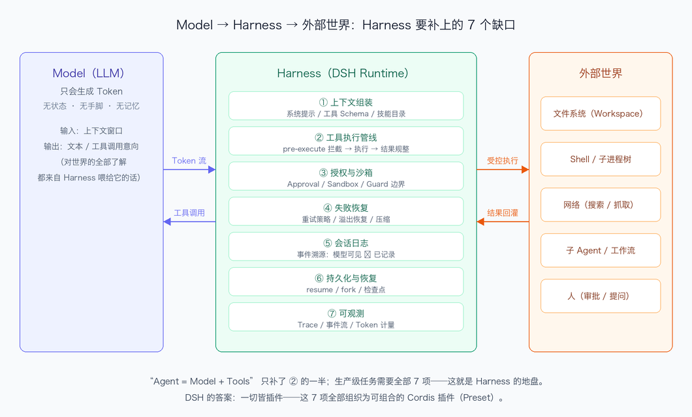

# DeepSeek Harness 技术入门 · Task01 打卡：为什么需要 Harness

> 课程：[Datawhale 组队学习《DeepSeek Harness 技术入门》](https://www.datawhale.cn/learn/summary/381)
> 对应内容：导读，为什么现在需要 Harness；第 1 章，Harness 不只是另一个 Coding Agent
> 实践环境：macOS 26.6 · Node.js v24.16.0 · DeepSeek Harness 0.2.0-rc.2，`npx @deepseek-ai/dsh web`
> 打卡日期：2026-10-12

---

## 一、学习内容归纳

这一章的出发点是一个听起来很简单、越想越不对劲的矛盾：模型只会生成 Token，而 Agent 要完成任务。中间差的那一整套东西，上下文、工具、权限、执行环境、失败恢复、会话日志，就是 Harness。它不是又一个套壳的 ChatUI，而是包裹模型循环的执行框架。

第 1 章给我印象最深的区分是产品和 Runtime。CLI 界面、Web 界面这些是产品，会跟着版本频繁地改；底下那套组织方式，模型怎么接进来、工具怎么注册、会话怎么记录、循环怎么驱动，才是 Runtime。产品层面的事不用太较真，Runtime 层面的语义才值得认真学。

我把模型到能干活的 Agent 之间的缺口归成了七项，也就是作业 A 那张图里画的：

1. 上下文组装。系统提示、工具 Schema、技能目录，模型对世界的全部了解都来自这里。
2. 工具执行管线。pre-execute 拦截、执行、结果规整，而不只是注册一个函数完事。
3. 授权与沙箱。Approval、Sandbox、Guard，哪些操作要人批准。
4. 失败恢复。重试策略、溢出恢复、压缩。
5. 会话日志。事件溯源，模型可见的就等于已记录的。
6. 持久化与恢复。resume、fork、检查点。
7. 可观测。Trace、事件流、Token 计量。

Agent 等于 Model 加 Tools 这个流行公式，细看只补了第 2 项的一半。DSH 的答案是"一切皆插件"，上面这七项全部组织成可组合的 Cordis 插件。这句话我在后面三个 Task 里反复验证了，确实成立。

关于 Developer Preview，我自己的读法是：组合语义、事件契约、patch 方言这些属于稳定承诺，可以认真学；具体工具的参数、prompt 文案、CLI 参数是版本敏感的，会漂移。学语法，别背词表。这个判断在 Task03 里还被我抓到了实锤，后面再说。

## 二、作业 A：示意图

三个区域之间的箭头就是 Harness 的日常工作：把模型的工具调用意向变成对外部世界的受控执行，再把结果回灌进上下文。七个缺口全部住在中间那一列。

## 三、作业 B：为什么 DSH 值得单独写一本书？

大多数 Agent 框架公开的是怎么调用，DSH 公开的是为什么这样组织。模型适配、工具注册、会话记录、Agent 循环，没有一项是写死的，全部是插件。一切皆插件不是口号，是可以在 preset 的 YAML 定义里逐行验证的事实，这一点后面每个 Task 都在加强。它开放的不只是 Tool 清单，还有 Tool 周围的运行机制，pre-execute 拦截、执行管线、结果规整、Loop 控制，注册一个回调之外的世界全部可见。会话即事件日志，模型可见等价于已记录，这条可重构性让每次运行都可以回放、可以分叉，同类项目里我没见过第二家做得这么彻底的。官方还直接内置了四套 Preset，Standard、PTC、Minimal、Creator，等于把同一个 Runtime 换不同能力组合这件事做成了可以当场运行的示列。再加上从 Node 版本约束到沙箱边界，工程细节和设计权衡都有源码出处，能按图索骥。一本书值得写，不是因为项目 star 多，而是因为它把 Agent 软件应当如何组织这个问题回答得足够彻底，而且答案可以被任何人检验。

## 四、自测问题

**1. Harness 一词的原意是什么？为什么贴切？**
马具，挽具。套在马身上，让人能驾驭马，把马的力量转化成可控拉力的那套装备。马的力量很大但不接受细节指挥，Harness 不替代马，提供的是驾驭接口和做功接口，缰绳对应循环控制，挽具对应工具执行。LLM 也一样，生成能力是模型自己的，Harness 负责把生成 Token 转化成受控地完成任务。

**2. 一切皆插件和多加几个 Tool 的区别在哪里？**
多加几个 Tool 改变的只是模型可见的函数清单，解决的是能力有没有的问题。一切皆插件让运行机制的每个环节都可以替换，拦截、执行、结果处理、循环控制，连 Agent 循环本身都是插件。一个是往筐里加鸡蛋，一个是连筐带货架都能换。

**3. DSH 中哪些部分是稳定的架构语义，哪些是版本敏感的？**
稳定的是组合语义，scope、isolate、服务注入，还有事件契约和 patch 方言。版本敏感的是具体工具的参数 schema、prompt 文案、CLI 参数、Preset 的默认组合内容。Developer Preview 阶段这些会常调，学的时候要分清哪边。

## 五、收获与卡点

收获：把根本矛盾画成了七缺口示意图，对产品 vs Runtime 有了判断力。这直接改变了我读更新日志的方式，先问改的是组合语义还是某个插件行，前者认真重读，后者扫一眼就行。

卡点：Developer Preview 里哪些语义承诺稳定，没有一份明确清单，只能靠 changelog 跟。这个坑在 Task03 里果然踩到了。
