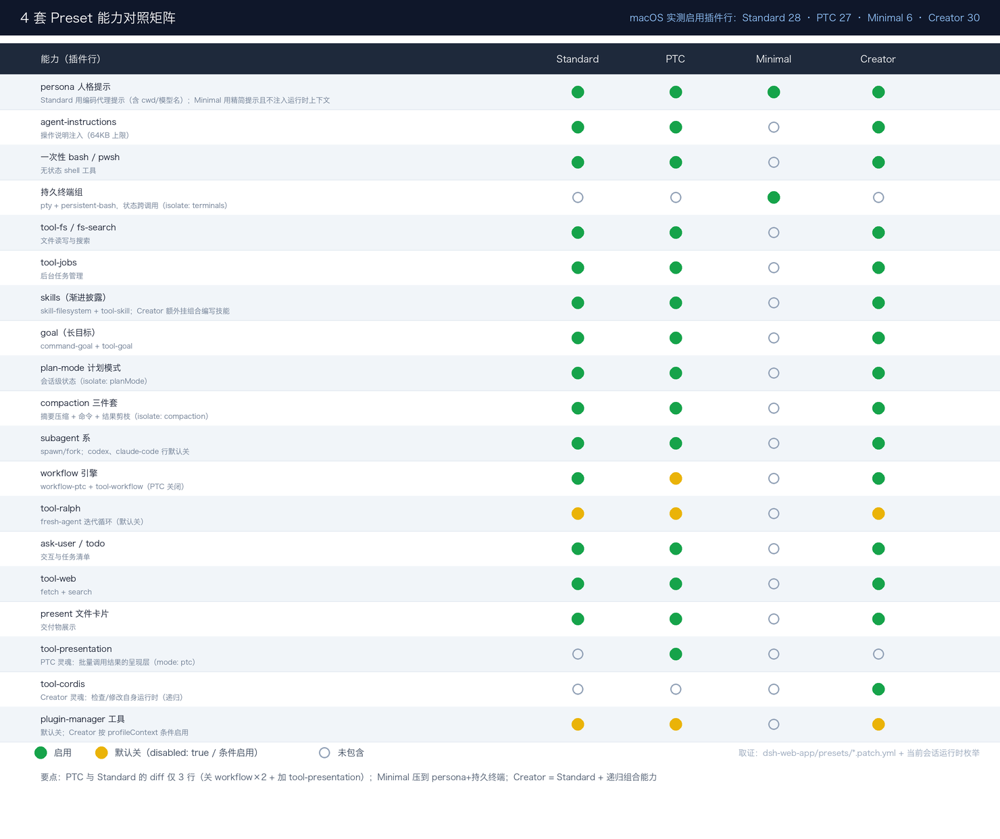

# DeepSeek Harness 技术入门 · Task02 打卡：从零运行 DSH + 4 套 Preset 对照实验

> 课程：[Datawhale 组队学习《DeepSeek Harness 技术入门》](https://www.datawhale.cn/learn/summary/381)
> 对应内容：第 2 章，从零运行 DeepSeek Harness；Task2 实验，4 套 Preset 能力对照与执行轨迹差分
> 实践环境：macOS 26.6 · Node.js v24.16.0，满足 `^22.19.0 || >=24`；DeepSeek Harness 0.2.0-rc.2，`npx @deepseek-ai/dsh web`，Web UI 在 127.0.0.1:3080
> 打卡日期：2026-10-12

---

## 一、学习内容归纳

环境这块没什么波折，Node 是 v24.16.0，满足版本要求，Web UI 一条命令就起来了。真正要记住的是安全习惯：Workspace 是 Agent 的现实世界，它能在里面干什么取决于组合给了它什么，所以实验一律在独立空目录里做。我这次的全部实验材料都放在单独目录，没碰工作区外面的文件。

四套 Preset 是同一个 Runtime 的四种能力组合，这句话是本 Task 的题眼。macOS 下我把每套组合实际启用的插件行数了出来：

| Preset | 界面名 | 启用插件行 | 定位 |
|---|---|---|---|
| standard | 标准模式 | 28 | 全能基线 |
| ptc | PTC 模式 | 27 | 同一批能力，加结果呈现层 |
| minimal | 极简模式 | 6 | 压薄 Harness，固定 Prompt 加持久终端 |
| cordis | 创造模式 | 30 | 标准之上加自我指涉 |

比结论更有用的是方法论。模型对自身能力的说明不能当证据，它只能复述上下文里的提示词，工具清单真正活在每次请求的 tools 数组里，没列出来的它感知不到，而且它会幻觉。想知道一个 Agent 能干什么，去问它是问不出来的，要看运行时，看 Trace 里的实际请求，看插件清单，看 preset 定义文件。这个习惯我觉得比记住任何结论都值。

## 二、能力对照矩阵



取证来自两处，本机 `dsh-web-app/presets` 目录下四个 patch 文件的逐行核对，加上当前会话运行时工具目录的枚举，两边对得上。

数完之后有三个发现印象很深。PTC 和 Standard 的 diff 只有三行，关掉 workflow-ptc 和 tool-workflow 两行，加上 tool-presentation 一行，mode 是 ptc。所谓换一种工作方式，源码层面就是三行 YAML 的事。Minimal 只剩六行，一个精简 persona，配置里 includeRuntimeContext 是 false，连 cwd 和模型名都不注入，加一个持久终端组，isolate 的是 terminals。Creator 等于 Standard 加 tool-cordis 再加组合编写技能，多出来的不是某个功能插件，是让 Agent 操作自己运行时组合的递归能力。

## 三、实验记录

### 实验 1：能力对照取证

方法就是不问模型，直接读 preset 定义加枚举运行时工具目录。结果就是上面那张矩阵。我当前这个会话跑在创造模式下，实测工具目录里有 cordis_inspect_list、cordis_inspect_query、plugin_manager，技能目录里是 cordis-plugin-development 那一批，和 cordis.patch.yml 的预测逐项吻合。四套 Preset 的差异可以在挂载之前就从配置精确推出来，这就是组合而不是定制分支的含义。

### 实验 2：执行轨迹差分

任务是读目录，建三个文本文件，统计总行数，给摘要。

先交代一下记录状态，免得误导：这份差分是基于 preset 组合推导的预期结果，可用工具决定轨迹形态，四个 Session 的实测数字我还没跑完，复现命令附在后面，跑完把数字填进去。

| 维度 | Minimal 预期 | Standard 预期 | PTC 预期 |
|---|---|---|---|
| 可用路径 | 只有持久 bash | fs、bash、todo | fs、bash、presentation |
| 建文件 | heredoc 或 echo 三连 | 三次 fs write，可并行 | 同 Standard，批量调用更激进 |
| 统计行数 | `wc -l`，终端状态可复用 | bash 一次 | 同 Standard |
| 预计步数 | 最多 | 中 | 中，省轮次但多一次呈现汇总 |
| 轨迹特征 | 原始但连贯 | 工具化、结构化 | 批量调用加结果呈现 |

官方 Benchmark 为什么选 Minimal，我想明白了一层。模型能力不等于 Agent 能力，Minimal 把 Harness 的影响压到最薄，固定 Prompt，不注入运行时上下文，单一工具面，这样测出来的差异才能归因到模型本身。工具越丰富，成绩越取决于 Runtime 怎么组合，那就是 Agent Benchmark 的地盘了。

复现方法，Web UI 里新建四个 Session 分别选四套 preset，输入同一段任务，记录各自的步数、工具调用序列和最终答案：

```text
请读取当前目录，创建 a.txt/b.txt/c.txt 三个文件（各写几行内容），
统计三个文件的总行数，并给一段摘要。
```

## 四、自测问题

**1. 为什么模型对自身能力的说明不能当证据？应该看什么？**
模型能复述的只有上下文里的提示词和 persona。工具清单在请求的 tools 数组里，没进请求的它感知不到。再叠加幻觉，问出来的东西不可靠。应该看运行时证据，Trace 里的实际请求、插件和工具的枚举、preset 定义文件。

**2. Preset 改变的是能力是否存在，还是能力如何呈现？两者是几件事？**
两件事。能力是否存在看 Tool Registry 的清单，Standard 到 Minimal 是这一类的大改。能力如何呈现看结果的呈现方式，Standard 到 PTC 基本不动清单，只加了一个 presentation 插件。PTC 就是同一批能力换一种呈现的官方实证。

**3. 模型在纯模型 Benchmark 上很强，放进任何 Agent Runtime 都同样强吗？**
不会。Agent 的成绩大致是模型能力乘以 Runtime 组合乘以上下文策略。工具面的宽窄、结果的呈现方式、失败恢复的处理，都会改变模型能不能把能力发挥出来。所以测模型的 Benchmark 要用 Minimal 这种压薄的组合来隔离变量。

## 五、收获与卡点

收获：养成了配置取证优先于提问的习惯。拿到一个 Agent 系统，先翻它的组合定义，比问它十个问题都准。PTC 和 Standard 只差三行这件事，让一切皆插件从口号变成了可以量化的信任。

卡点：实验 2 的实测轨迹还没跑完，预期差分已经给出，数字留着后面补。PTC 不一定更快这个判断的边界，批量场景赚、单任务亏，也还需要实测数据支撑。
