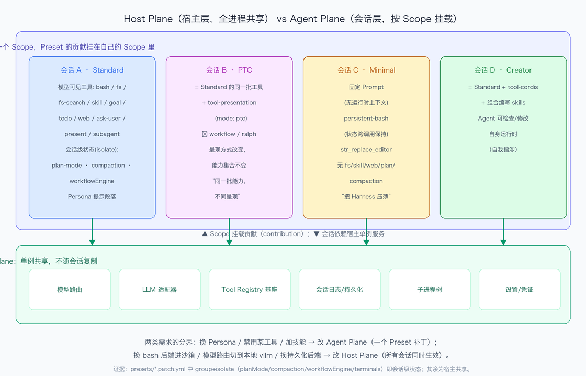

# DeepSeek Harness 技术入门 · Task03 打卡：Preset / Scope / Host Plane / Agent Plane

> 课程：[Datawhale 组队学习《DeepSeek Harness 技术入门》](https://www.datawhale.cn/learn/summary/381)
> 对应内容：第 3 章前半，拆解"一切皆插件"原则的上篇，加 Task3 概念辨析
> 实践环境：macOS 26.6 · Node.js v24.16.0 · DeepSeek Harness 0.2.0-rc.2
> 打卡日期：2026-10-12

---

## 一、学习内容归纳

这章概念密度是前几章里最高的，四个核心概念我按自己的理解各写一句。

Preset 是一份声明式的插件组合清单，一张 patch YAML，描述一个会话的能力面。Scope 是组合的边界，Preset 的贡献挂进会话自己的 Scope，可见性和生命周期都由 Scope 决定，会话级能力从哪里来、动态组合为什么必须有边界，答案都在这。Host Plane 是宿主层，进程级单例，模型路由和 LLM 适配器、Tool Registry 基座、会话日志和持久化、子进程树、设置和凭证，不随会话复制，所有会话共享但中立。Agent Plane 是会话层，每个会话一片，靠 Scope 挂载 Preset 的贡献，靠 isolate 拿到私有服务实例。

为什么不是每个 Session 复制一套完整插件树，我想了挺久。复制的好处是隔离彻底，代价是资源浪费、四份状态难保持一致、插件一更新就要逐会话重放。反过来全做成全局单例，省资源，但会话之间互相污染，A 加的工具会漏进 B 的目录，也没法按会话定制能力面。DSH 取中间，Host 单例，Scope 挂载，isolate 隔离私有服务，四套 Preset 共享同一个 Runtime 还互不干扰。

Standard 基线的拆法，书上叫三类组合项。面向模型的工具是工具面，会话级状态是 isolate 出来的服务，Host 能力适配项是基座。作业 A 的表里我把十项能力逐个归了类。

这章还有个计划外的收获。我把书上的描述和本机 0.2.0-rc.2 的 preset 定义逐行对照，抓到两处不一致。书里 Tool Presentation 写 mode 是 code，本机实测是 ptc。书里 Minimal 包含 str_replace_editor，本机的 minimal.patch.yml 里没有这个插件行，这个包在 npm 里存在，但没进当前版本的组合。Task01 自测题问哪些东西版本敏感，这回算是亲身验证了，具体参数和默认组合会漂移，patch 行、scope、isolate 这套组合语义没动。学语法别背词表，诚不欺我。

## 二、作业 A：Host Plane / Agent Plane 分层图

标注的 Standard 能力十项，多于要求的八项，归属如下：

| # | 能力 | 归属 | 提供者 | 开放对象 |
|---|---|---|---|---|
| 1 | Persona 提示段落 | Agent Plane，Scope 贡献 | dsh-persona | 模型，进上下文 |
| 2 | 文件读写和搜索工具 | Agent Plane，模型工具 | tool-fs、tool-fs-search | 模型，进 tools 数组 |
| 3 | Shell 工具 | Agent Plane 的工具面，底下踩 Host 子进程树 | tool-bash，能力缝隙后端 | 模型 |
| 4 | Skills | Agent Plane，渐进披露 | skill-filesystem 加 tool-skill | 模型，按需加载 |
| 5 | Plan Mode | Agent Plane，isolate planMode | dsh-plan-mode | 模型和会话 |
| 6 | Compaction 三件套 | Agent Plane，isolate compaction | dsh-compaction 系列 | 会话，管上下文存活 |
| 7 | Subagent 和 Workflow | Agent Plane，isolate workflowEngine | dsh-tool-subagent、workflow | 模型，管委托 |
| 8 | 模型路由和 LLM 适配 | Host Plane 单例共享 | llm 适配器注册表 | 所有会话 |
| 9 | 会话日志和持久化 | Host Plane | session-persistence | 所有会话 |
| 10 | 设置和凭证 | Host Plane | settings、credentials | 所有会话 |

对照书里的组合树，Persona、Filesystem、Shell、Search、Skills、Plan、Subagent、Workflow、Interaction 九项，前七项的工具面加上 Interaction 全落在 Agent Plane，Model Route、Persistence、Settings 是 Host 侧的适配项，和三类组合项的分法完全对得上。

## 三、作业 B：改 Agent Plane 与改 Host Plane 是两类需求

我自己的例子。改 Agent Plane，给对外演示的会话写一个 preset 补丁，禁用 tool-web 和 present，把 persona 换成只读代码讲解员。同一台 DSH 里我自己的工作会话完全不受影响。这对应书里那个禁用写文件工具的例子，一个 patch 行 disabled 改成 true 的事。

改 Host Plane，把 bash 能力缝隙的后端从 bash-local 换成 bash-sandbox，从此任何会话、任何 preset 里的 shell 都进沙箱。或者把模型路由切到本地 vllm 端点，所有会话的下一个请求都走新路由。这对应书里所有文件操作进远程容器的例子，改的是能力的实现，不是能力的组合。

我自己总结了一个判断方法，想不清一个需求该改哪里，就问这个改动让谁看见。一个会话看见，就是 Agent Plane 的事。所有会话都看见，就是 Host Plane 的事。

## 四、自测问题

**1. DSH 的分层避免了哪两种极端？各自代价是什么？**
一端是每个会话完整复制插件树，隔离彻底，但资源浪费、多份状态难一致、插件更新要逐会话重放。另一端是全部全局单例，省资源，但会话互相污染，A 的工具漏进 B 的目录，也没法按会话定制。DSH 取中，Host 单例加 Scope 挂载加 isolate 私有实例。

**2. 会话 A 新增的 Tool 影响到会话 B，问题出在哪一层？**
作用域层。这个贡献被注册进了全局或宿主层，没有待在 A 的 Agent Scope 里，也可能是服务没 isolate，实例从 preset 泄漏到了 Host。修法是挪回 Scope 贡献，或者补 isolate 映射。

**3. PTC 与 Standard 在源码层面的差异有多小？改变的是什么？**
三行 YAML。workflow-ptc 和 tool-workflow 两行 disabled，加一行 tool-presentation。改变的不是能力集合，是结果的呈现方式。所以 PTC 不一定更快，round-trip 压缩在批量调用场景赚，单任务可能反而多一次汇总呈现。

## 五、收获与卡点

收获：拿 preset 定义里 group 加 isolate 的写法当会话级状态的实证，把四个概念落到同一张图上。那个判断方法，问这个改动让谁看见，估计以后能一直用。两处书和版本的差异也让我对版本敏感有了体感。

卡点：同一个 shell 字眼横跨两层，终端服务是 isolate 的会话级，子进程树是 Host 共享，词面相同层级不同，不翻定义很容易想当然。这类词我得专门记一个清单。
