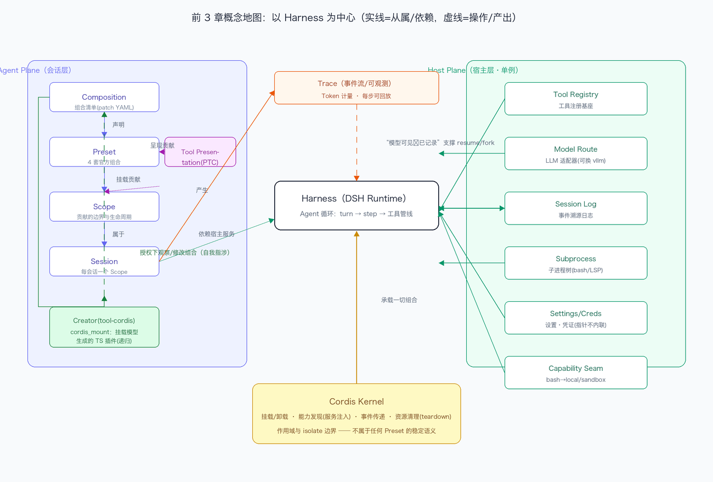

# DeepSeek Harness 技术入门 · Task04 打卡：Creative 模式、Cordis Kernel 与"一切皆插件"收官

> 课程：[Datawhale 组队学习《DeepSeek Harness 技术入门》](https://www.datawhale.cn/learn/summary/381)
> 对应内容：第 3 章后半，拆解"一切皆插件"原则的下篇，含 3.8 内核与 3.9 小结，加前 3 章综合复盘
> 实践环境：macOS 26.6 · Node.js v24.16.0 · DeepSeek Harness 0.2.0-rc.2，本 Task 笔记在创造模式会话里完成
> 打卡日期：2026-10-12

---

## 一、学习内容归纳

Creative 的创造指什么，我的理解是递归。cordis_mount 能把模型生成的 TypeScript 代码作为插件动态挂载进当前 Agent 的 Scope，也能卸载，也能重新解析依赖。也就是说承载 Agent 的那个组合，本身成了 Agent 的操作对象。Agent 改的是自己正在上面跑的运行时，这种设计我头一次见。

它为什么是高信任能力也顺理成章了。能改 Runtime 的人就能改权限边界，能注入行为。所以它的风险要靠三层东西兜住，授权流程，沙箱约束，还有默认不开放。对照 preset 定义看得很清楚，tool-cordis 只出现在 cordis 这个组合里，Standard、PTC、Minimal 都没有它。

这章最容易被误解的一点，一切皆插件不等于没有内核。Cordis Kernel 保留了一组不属于任何 Preset 的稳定语义，挂载和卸载，能力发现也就是服务注册与依赖注入，事件传递包括派发模式和拦截语义，资源清理靠可逆注册和 teardown 顺序，还有作用域与 isolate 的边界。Kernel 不提供任何面向模型的能力，但所有能力的组合规则由它裁定，谁都改不了。

用四套 Preset 反证一切皆插件，我横向比了一遍。同一个能力维度在不同组合里换法不同。角色，persona 在 Standard 是编码代理，Minimal 是精简助手。提示词，agent-instructions 有的组合有有的没有。呈现，tool-presentation 只在 PTC。上下文策略，compaction 三件套加运行时上下文注入的开关。Runtime 自操作，tool-cordis 只在 Creative。五个维度全部是插件行，没有一个是硬编码分支。

## 二、作业 A：概念地图，前 3 章综合复盘

以 Harness 为中心，收了十八个术语。任务要求的十一个都在，Preset、Scope、Host Plane、Agent Plane、Tool Registry、Model Route、Tool Presentation、Cordis Kernel、Session、Trace、Composition。另外补了 Capability Seam、Session Log 事件溯源、resume 和 fork、Subprocess、Settings 和 Credentials、tool-cordis 的递归操作。

图上的关系这样读，实线是从属或依赖，虚线是操作或产出。Composition 声明 Preset，Preset 挂载贡献进 Scope，Scope 属于 Session，这是 Agent Plane 的主链。Cordis Kernel 承载一切组合。Session 依赖宿主服务，Tool Registry、Model Route、Session Log、Subprocess、Settings 都是 Host Plane 单例。Session 产生 Trace，Session Log 靠模型可见等价于已记录这条性质支撑 resume 和 fork。Creator 的 tool-cordis 在授权下观察和修改 Composition，这就是那个递归。

## 三、作业 B：短文《我理解的"一切皆插件"》

DSH 把模型适配、工具注册、会话记录、Agent 循环这些环节全部做成了插件。一开始我以为这只是工程上的洁癖，学完前三章才看懂它解决的问题。Agent 系统的需求维度太多了，模型要换，工具要加，提示词要调，结果的呈现要变，上下文策略要收紧，安全边界要收放。这些维度一旦写死在代码里，每一种组合需求都会逼出一个分支，组合越多分支越爆炸。DSH 把所有维度统一成插件行加声明式的组合清单。我在本机的 preset 定义里逐行数过，Standard 启用 28 个插件行，PTC 是 27 个，两者的差异只有三行，关掉 workflow 两项，加上一个结果呈现插件。Minimal 是 6 行，Creator 是 30 行。所谓换一种 Agent，在这里就是换一份 YAML，四种形态底下是同一个 Runtime。

但它不等于没有内核。Cordis 内核保留了一组不属于任何 Preset 的语义，挂载与卸载，能力发现，也就是服务注册和依赖注入，事件传递，资源清理，还有作用域和 isolate 的边界。插件再自由，也要经过内核的装载语义和生命周期管理，所以我说它是微内核而不是无内核。最能说服我的证据是 isolate。preset 只能声明自己需要一个隔离的服务实例，比如 planMode 或者 compaction，这条声明之所以算数，是因为内核的作用域语义在兜底。内核不提供能力，但能力的组合规则由它裁定，谁都改不了。

它和多注册几个 Tool 的差别，我自己的总结是看改的是清单还是机制。注册一个 Tool，改变的只是模型看得见的函数清单，回答的是能力有没有的问题。插件化之后，能力怎么组织、怎么呈现、怎么拦截、怎么回收，全都变成可组合的东西。persona 是插件，管提示词维度。tool-presentation 是插件，管呈现。compaction 是插件，管上下文策略。tool-cordis 也是插件，管 Runtime 自操作。这四样东西压根不是 Tool，却吃同一套组合语义。Task03 里我学到一个判断方法，问这个改动让谁看见。改 Agent Plane，一行 patch 换掉一个会话的人格。改 Host Plane，换个后端，所有会话的 shell 都进沙箱。多注册 Tool 永远只在清单里做加法，碰不到清单本身的表达力。

## 四、自测问题

**1. cordis_mount 做了什么？为什么说 Creative 让 Runtime 本身成为可操作对象？**
把模型生成的 TS 代码作为插件挂进当前 Agent 的 Scope，授权范围内，可以卸载，可以重解析依赖。承载 Agent 的组合成了 Agent 的操作对象，Agent 修改的是自己正在其中运行的运行时，这是递归设计。高信任能力的风险边界靠授权、沙箱、默认不开放三层控制。

**2. Cordis Kernel 负责哪些不属于任何 Preset 的规则？**
挂载卸载的语义和生命周期，能力发现，包括服务注册表、inject 声明和加载顺序，事件传递的派发模式与拦截语义，资源清理的可逆注册和 teardown 顺序，还有两级作用域与 isolate 边界。

**3. 有人说 DSH 就是微内核操作系统，这个类比哪里对、哪里不对？**
对的部分，Kernel 小而稳定，能力全在可插拔的插件里，组合是声明式的。不对的部分，它不管理硬件资源，没有进程级或硬件级的强制隔离，插件共享同一个进程世界，安全边界靠 Approval 和 Sandbox 的策略事件实现，靠的不是内核强制的系统调用屏障。更准确的说法是微内核式的组合语义，运行在单进程世界里。

**4. 回顾全程，Task 2 观察到的 4 套 Preset 差异，现在能用 Task 3/4 的概念解释了吗？**
能。差异等于同一个 Kernel 加同一个 Host Plane 上不同的 Scope 贡献集合。PTC 和 Standard 只差一个呈现插件，能力不变，呈现变了。Minimal 是把贡献压到 persona 加持久终端，terminals 走 isolate。Creator 多了一个能操作组合本身的插件，递归。四个形态是四份组合清单，不是四个产品分支。

## 五、收获与卡点，兼结营小结

画完概念地图，前三章才算连成一条线。Composition 声明 Preset，Preset 挂进 Scope，Scope 属于 Session，Session 踩在 Host 单例上，全部由 Kernel 的组合语义承载。Creative 的创造，无非是把改这条链的笔递给了 Agent。

回头看四个 Task 恰好是一个闭环。Task一给了矛盾框架，七缺口那张图我到现在还留着。Task二给了方法论，配置取证优先于提问，拿到系统先翻组合定义。Task三给了结构，两层两 Plane 加一句口诀。Task四补上了内核观，声明与机制分离。

卡点和展望。概念都通了，但还没亲手写过 Skill、Tool 和 Hook，第 4 章的动手环节就是下一站，从消费组合的人变成生产组合的人。另外微内核类比的边界提醒我别把插件化浪漫化成随便挂，same-world 的世界里高信任就是高风险。
